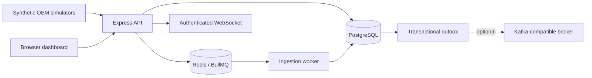

# Parallax

Parallax is a synthetic fleet telemetry service. It accepts several OEM-shaped payloads, stores the original request, normalizes each event, tracks current vehicle state, and exposes tenant-scoped APIs and a monitoring dashboard. It does not connect to real OEM systems or vehicles.

## Capabilities

- Independent request receipts and event outcomes, including batch ingestion and quarantine.
- Idempotent telemetry and operational events, with event-time vehicle state.
- Vehicle, history, ingestion, quarantine, and dashboard APIs.
- A responsive HTML/CSS/vanilla JavaScript dashboard with token-based sign-in.
- Optional Redis/BullMQ processing and Kafka-compatible outbox/consumers.
- Synthetic Alpha, Beta, and Gamma simulators.

## Stack

Node.js 24, Express, PostgreSQL 18, Prisma, Redis, BullMQ, Socket.IO, KafkaJS, and Playwright.

## Architecture



PostgreSQL is authoritative. The API commits the raw request before processing its events. Redis and Kafka are optional locally; the hosted demo uses Redis/BullMQ and disables Kafka.

## Local setup

Requirements: Node.js 24 and npm 11, plus Docker Desktop (recommended) or PostgreSQL 18.

With Docker Compose:

```sh
npm ci
docker compose up --build
```

Open [http://localhost:3000](http://localhost:3000). Compose starts PostgreSQL, Redis, Redpanda, migrations, seed, web/API, and workers.

For a direct local setup, copy `.env.example` to `.env`, set separate `DATABASE_URL` and `TEST_DATABASE_URL` databases named `parallax_dev` and `parallax_test`, then run:

```sh
npm run db:migrate
npm run db:seed
npm run dev
```

## API credentials and dashboard

Local development seeds the `demo` organization and permits unauthenticated local API access. To exercise production-style access, create role-scoped API clients from a trusted shell:

```sh
npm run client:create -- demo "Dashboard" VIEWER
npm run client:create -- demo "Simulator" INGESTOR
npm run client:create -- demo "Vehicle registration" ADMIN
```

Each command prints a client ID and one-time secret. Exchange a client credential at `POST /api/v1/auth/token`, then enter the dashboard client's credentials in the **Connect** panel. A viewer can inspect; an ingestor can send telemetry; an admin can register or update vehicles. Production organization and role are resolved from the active client record, never from client-supplied organization IDs.

## Tests

```sh
npm test
npx prisma validate
npm audit --omit=dev
```

The full test command includes PostgreSQL integration/API/unit tests and Playwright browser tests. See [CI](.github/workflows/ci.yml) for the production image and secret checks.

## Documentation

- [Deployment](docs/DEPLOYMENT.md)
- [Production readiness](docs/PRODUCTION_READINESS.md)
- [Security](docs/SECURITY.md)
- [Operations](docs/OPERATIONS.md)
- [Architecture](docs/architecture.md)
- [Data contracts](docs/data-contracts.md)
- [Decisions](docs/decisions/)
- [Benchmarks](docs/benchmarks/README.md)
