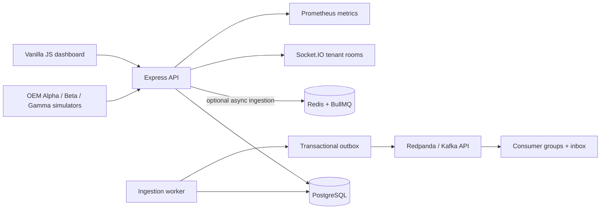

# Parallax

Parallax is a synthetic multi-OEM vehicle telemetry normalization and event processing platform. It accepts different OEM payloads, preserves raw receipts, normalizes measurements, maintains event-time vehicle state, quarantines invalid data, detects operational events, and exposes tenant-scoped monitoring APIs and dashboard views.

All vehicle data is synthetic. The project does not connect to real OEM systems or use proprietary Motorq data.

## Architecture



The modular monolith separates HTTP, services, adapters, repositories, workers, and optional streaming. PostgreSQL is authoritative. Raw request bytes commit before parsing, and each extracted event is processed in its own transaction. Production requires Redis and queues durable request IDs for BullMQ; synchronous processing is a local/test convenience. When streaming is explicitly enabled, accepted readings create a transactional outbox row in the same transaction, so Kafka outages do not lose accepted data.

See [architecture](docs/architecture.md), [data contracts](docs/data-contracts.md), and [ADRs](docs/decisions/) for entity relationships, transaction boundaries, event ID scope, and operational tradeoffs.

## Features

- Independent Alpha (imperial), Beta (metric), and Gamma (nested SI) payload adapters.
- Deterministic simulators with malformed, duplicate, delayed, out-of-order, and disconnected scenarios.
- Byte-preserving request receipt storage (`BYTEA`), parsed JSON (`JSONB`), event-level outcomes, and request/event quarantine.
- Database-enforced telemetry idempotency and event-time state ordering using a conditional PostgreSQL UPSERT.
- Late historical readings without false odometer regressions; suspicious newer odometers are flagged and quarantined while other measurements remain usable.
- Vehicle, historical telemetry, state, ingestion, quarantine, event, and dashboard summary APIs.
- Revocable organization API clients, bcrypt-hashed secrets, short-lived bearer tokens, database-resolved `VIEWER`/`INGESTOR`/`ADMIN` roles, Helmet headers, and API/token rate limits.
- BullMQ retry/dead-letter flow and pending-request recovery when Redis is enabled.
- Deterministic operational events and event deduplication.
- Transactional outbox to Kafka-compatible Redpanda, per-vehicle message keys, separate consumer groups, and database-backed inbox idempotency.
- Socket.IO notifications scoped to the resolved organization room.
- Structured request logs and Prometheus-compatible HTTP, queue, and outbox metrics.
- Responsive dashboard using API data only; credentials and tokens are held in page memory, not browser storage.
- Liveness/readiness endpoints, request IDs, JSON logs, process-local Prometheus metrics, and a Redis worker heartbeat.

## Technology

| Area | Implementation |
|---|---|
| Runtime and API | Node.js 24, Express, JavaScript |
| Database | PostgreSQL 18, Prisma |
| Dashboard | HTML, CSS, Vanilla JavaScript |
| Tests | `node:test`, Supertest, PostgreSQL integration tests |
| Background jobs | Redis, BullMQ |
| Streaming | KafkaJS with Redpanda locally |
| Realtime | Socket.IO |
| Security | bcryptjs, JOSE JWT verification, Helmet, express-rate-limit |
| Browser E2E | Playwright Chromium |

## Requirements

- Node.js 24 and npm 11.
- PostgreSQL 18 for the direct local setup, or Docker Desktop with Docker Compose for the complete stack.
- Redis and Redpanda are only needed for background and Kafka execution outside Compose.

## Local setup

1. Install packages and prepare environment values:

   ```sh
   npm ci
   cp .env.example .env
   ```

2. Set `DATABASE_URL` and `TEST_DATABASE_URL` in `.env` to separate databases named `parallax_dev` and `parallax_test`. Tests reject any other test database name.

3. Apply committed migrations and seed the local demo organization:

   ```sh
   npm run db:migrate
   npm run db:seed
   ```

4. Start the API and dashboard:

   ```sh
   npm run dev
   ```

   Visit [http://localhost:3000](http://localhost:3000). In non-production local mode, APIs use the seeded `demo` organization without asking the client for an organization ID.

### Environment variables

| Variable | Purpose | Default |
|---|---|---|
| `DATABASE_URL` | PostgreSQL development or production DB | Required |
| `TEST_DATABASE_URL` | Isolated integration-test database | Required for database tests |
| `PORT` | HTTP port | `3000` |
| `API_RATE_LIMIT_PER_MINUTE` | Global API request limit per IP | `1200` |
| `MAX_PAYLOAD_BYTES` | HTTP request body limit | `65536` |
| `TOKEN_SIGNING_SECRET` | HS256 signing key; required in production, minimum 32 bytes | Local-only development key |
| `ACCESS_TOKEN_SECONDS` | Access token lifetime | `3600` |
| `METRICS_TOKEN` | Separate bearer token required to scrape `/metrics` in production | Required in production |
| `REDIS_URL` | Enables async ingestion and BullMQ | Required in production; optional local sync mode |
| `WORKER_CONCURRENCY` | Ingestion worker parallelism | `8` (Render starts at `4`) |
| `STREAMING_ENABLED` | Enables outbox publication to Kafka | `true` only when brokers are configured |
| `KAFKA_BROKERS` | Kafka-compatible broker addresses | No production default |
| `KAFKA_PARTITIONS` | Partitions created per topic | `3` |
| `DB_CONNECTION_LIMIT` | Prisma pool max per process | `10` |
| `DB_POOL_TIMEOUT_SECONDS` | Wait for a free Prisma connection | `10` |
| `DB_CONNECT_TIMEOUT_SECONDS` | Database connection timeout | `5` |
| `TOKEN_RATE_LIMIT` | Token exchange attempts per IP per 15 minutes | `20` |
| `MAX_BATCH_EVENTS` | Maximum events in one batch | `500` |
| `SIM_SOURCE` | Simulator OEM | `OEM_ALPHA` |
| `SIM_VEHICLES` | Synthetic VIN count | `3` |
| `SIM_SPEED` | Multiplier for simulator cadence | `1` |

Never use the local token signing key in production. Supply a random secret through your secret manager.

## Docker Compose

Compose starts PostgreSQL, Redis, Redpanda, migrations, demo seed, the API/dashboard, the ingestion worker, and Kafka publisher/consumer workers:

```sh
docker compose up --build
```

Open [http://localhost:3000](http://localhost:3000). Use the HTTP URL; opening `public/index.html` as a local file bypasses Express and prevents API calls. The stylesheet uses a project-relative asset path so the light UI still loads in a file preview. Redpanda's Kafka listener is exposed on port `19092`; the internal services connect to `redpanda:9092`. PostgreSQL, Redis, and Redpanda use named volumes. Database init creates separate `parallax_dev` and `parallax_test` databases.

Use `docker compose down` to stop the stack while preserving data. `docker compose down -v` removes its named data volumes and should only be used when you intentionally want to remove local Compose data.

The Compose Redpanda image follows the current official single-broker development setup ([Redpanda Compose guide](https://docs.redpanda.com/labs/docker-compose/single-broker/)). A single local broker demonstrates Kafka-compatible behavior; it does not provide the redundancy or operational guarantees of a managed production Kafka cluster.

Local Prometheus scrape endpoints are available on the API at `:3000/metrics`, worker at `:9465/metrics`, and stream process at `:9466/metrics`. Production requires `METRICS_TOKEN`. The worker publishes a short-lived Redis heartbeat consumed by API readiness.

For a production-shaped single-host Docker setup, use `docker-compose.production.yml`. It requires secrets, keeps PostgreSQL and Redis unexposed, runs migrations, and disables Kafka explicitly. For public hosting, review [the deployment guide](docs/DEPLOYMENT.md) and `render.yaml`.

## Migrations and seed

Committed migrations are applied without resetting data:

```sh
npm run db:migrate       # DATABASE_URL, restricted to parallax_dev outside production
npm run db:migrate:test  # TEST_DATABASE_URL, restricted to parallax_test
npm run db:migrate:prod  # production URL after deployment review
npm run db:seed
```

The demo seed is idempotent. Do not use destructive reset commands against the development database. CI applies all migrations to a clean isolated test database.

## API

Base path: `/api/v1`. Responses use `{ "success": true, "data": ... }`; failures use a stable error code and message. In production all organization-scoped routes require a bearer token. In local development, requests without a token use the seeded demo tenant. A client-provided `organizationId` is ignored.

### Client credentials

Create a tenant-scoped client from a trusted shell. The client secret is printed once; only its bcrypt hash is stored:

```sh
npm run client:create -- demo "Local dashboard" VIEWER
npm run client:create -- demo "Local simulator" INGESTOR
```

Exchange it for a short-lived access token:

```sh
curl -s http://localhost:3000/api/v1/auth/token \
  -H 'content-type: application/json' \
  -d '{"grant_type":"client_credentials","client_id":"px-…","client_secret":"…"}'
```

Revoke a credential immediately:

```sh
npm run client:revoke -- px-…
```

The dashboard's **Connect** panel accepts client credentials and keeps credentials/token only in page memory. A reload requires reconnecting.

### Endpoints

| Method | Path | Description |
|---|---|---|
| `POST` | `/api/v1/auth/token` | Client-credentials bearer token |
| `POST` | `/api/v1/vehicles` | Register VIN and OEM source |
| `GET` | `/api/v1/vehicles?limit=25&cursor=…&search=…&source=…&status=ACTIVE` | Tenant-scoped vehicle list; supports `ACTIVE`, `STALE`, and `OFFLINE` status filters |
| `GET` | `/api/v1/vehicles/:vehicleId` | Vehicle details |
| `PATCH` | `/api/v1/vehicles/:vehicleId` | Update supported source metadata |
| `POST` | `/api/v1/ingest/:source` | Ingest one event or a batch; preserves raw bytes first |
| `GET` | `/api/v1/summary` | Dashboard counts and source distribution |
| `GET` | `/api/v1/telemetry/recent?limit=10&cursor=…` | Recent normalized telemetry across the resolved organization |
| `GET` | `/api/v1/events/recent?limit=8&cursor=…` | Recent operational events across the resolved organization |
| `GET` | `/api/v1/ingestions?status=…` | Request history and batch counts |
| `GET` | `/api/v1/ingestions/:requestId` | Inspect receipt, event outcomes, quarantine details, and original raw bytes |
| `GET` | `/api/v1/quarantine?reason=…` | Quarantine details and original body bytes as Base64 |
| `GET` | `/api/v1/vehicles/:vehicleId/state` | Current state and trusted odometer |
| `GET` | `/api/v1/vehicles/:vehicleId/telemetry?from=…&to=…` | Event-time history with cursor pagination |
| `GET` | `/api/v1/vehicles/:vehicleId/events` | Operational event history |
| `GET` | `/health` or `/health/live` | Process liveness |
| `GET` | `/health/ready` | Database, Redis, and (in production) worker readiness |
| `GET` | `/metrics` | Prometheus text metrics; token-protected in production |

Ingestion accepts a source event object, an array, or `{ "events": [...] }`. The source path may contain unknown values; requests remain preserved and unknown sources are quarantined. A valid batch returns one result per event. A malformed JSON body returns HTTP 400 after its raw bytes and request-level quarantine are committed. Mixed event outcomes return HTTP 207.

Example Alpha event:

```json
{
  "vin": "1HGBH41JXMN109186",
  "speed": 60,
  "speed_unit": "mph",
  "odometer": 12500,
  "latitude": 12.9716,
  "longitude": 77.5946,
  "fuel_level": 74,
  "engine_on": true,
  "event_id": "ALPHA-EVT-10001",
  "timestamp": "2026-11-01T08:30:00Z"
}
```

Full OEM schemas, conversions, timestamp rules, status definitions, event support, and source-ID uniqueness assumptions are in [data contracts](docs/data-contracts.md).

## Simulators

The simulator registers its synthetic VINs through the vehicle API and then sends events through HTTP:

```sh
SIM_SOURCE=OEM_ALPHA SIM_VEHICLES=3 SIM_SPEED=2 npm run simulate
SIM_SOURCE=OEM_BETA SIM_VEHICLES=2 npm run simulate
SIM_SOURCE=OEM_GAMMA SIM_VEHICLES=4 npm run simulate
```

For an authenticated production-like API, set `PARALLAX_TOKEN` and optionally `INGEST_URL`. Scenario schedules are deterministic: periodic invalid fuel, repeated receipts, out-of-order timestamps, delayed delivery, and missed reports. The interval is per simulator tick, so a multi-vehicle set rotates through VINs.

## Background processing and Kafka

With `REDIS_URL` set, HTTP ingestion stores request bytes and pending event rows, then returns `202` while BullMQ processes the request. The worker uses five exponential-backoff attempts; exhausted jobs go to `parallax.ingestion.dead-letter`. On startup it re-enqueues durable incomplete requests. Without Redis, the API processes through the same service synchronously.

The Kafka publisher sends `telemetry.normalized.v1` and `operational.events.v1`, keyed by vehicle UUID. PostgreSQL leases outbox rows using `FOR UPDATE SKIP LOCKED`; broker errors release them for retry. Kafka acknowledgements and PostgreSQL cannot share one transaction, so delivery is at least once. Stable event keys and per-consumer-group inbox constraints make repeat processing idempotent. Each topic preserves per-vehicle order within a partition; there is no cross-topic ordering guarantee. Consumer groups `parallax.realtime.v1` and `parallax.analytics.v1` can scale independently. An outbox row remains durable while Kafka is unavailable.

Use `npm run worker:start` and `npm run stream:start` when running local Redis and Redpanda yourself. See [ADR-007](docs/decisions/ADR-007-transactional-outbox-and-kafka.md).

## Dashboard and realtime

The dashboard is served from `public/` and uses the live API for summary metrics, vehicles, telemetry history, ingestion outcomes, quarantine information, and operational events. It includes loading, empty, and error states, filters, pagination, responsive views, and a tenant-scoped Socket.IO connection. No sample/fake counts are embedded in the UI.

## Tests and code checks

Tests use the separate `parallax_test` database. The command migrates and seeds only that database before integration/API suites, then runs Playwright against a test-mode HTTP server:

```sh
npm test
```

The suites cover database constraints, BYTEA/JSONB, request/event lifecycle, concurrency, idempotency, API validation, cross-tenant access, role boundaries, expired/revoked credentials, adapters, and event-time odometer behavior. The browser journey covers dashboard load, vehicle inspection, ingestion detail, quarantine, operational events, and mobile-width overflow. JavaScript syntax checks, Prisma validation, production dependency audit, secret scan, and Docker image build run in GitHub Actions.

## Benchmarking

Start the API first, then run a reproducible end-to-end load against synthetic fixtures:

```sh
BENCH_EVENTS=1000 BENCH_CONCURRENCY=16 BENCH_BATCH_SIZE=25 npm run benchmark
```

The script records machine/Node/PostgreSQL information, direct and batch request latency percentiles, throughput, duplicate receipt latency, vehicle list/detail/history and dashboard-summary latency, request completion delay, HTTP error rate, event rejection rate, queue mode, outbox publication, Kafka inbox delivery, persisted row counts, and `EXPLAIN ANALYZE` output. With `REDIS_URL` and `KAFKA_BROKERS` set for the benchmark process, it waits for request completion and stream delivery or fails on timeout. It cleans up its tenant-scoped fixture after writing a JSON report under `docs/benchmarks/`. Increase workload only when the local host can run it without interfering with other services. Do not treat unexecuted or synthetic estimates as benchmark results.

## Deployment and CI

`Dockerfile` is a multi-stage, non-root production image. `docker-compose.yml` provides a local full stack and `docker-compose.production.yml` is a secret-required single-host alternative. `.github/workflows/ci.yml` installs dependencies, creates an isolated PostgreSQL test database, validates Prisma, applies migrations, runs browser/API/unit/integration tests, audits production dependencies, scans for secrets, and builds the production image. No cloud resources or paid services are provisioned automatically.

For public hosting, follow [the deployment guide](docs/DEPLOYMENT.md) and review the live `render.yaml` Blueprint before provisioning. It selects Render with managed PostgreSQL and Redis-compatible queueing, one web process, and one worker. Kafka is intentionally disabled for that cost-conscious synthetic demo. TLS/custom domain require provider setup. The local Compose Redpanda node is development-only.

## Security and known limits

- Client secrets are bcrypt-hashed; access tokens expire and every API request checks that the client remains active and enforces its database role.
- Production never falls back to the demo organization; vehicle, telemetry, ingestion, quarantine, and event queries use the verified organization.
- Raw bytes are capped by `MAX_PAYLOAD_BYTES`; parsed batches are capped at 500 events.
- Vehicle state uses a PostgreSQL conditional UPSERT. Suspicious newer odometers stay in history but do not replace the trusted value; late historical odometers do not trigger false regression warnings.
- Synthetic OEM schemas do not imply real OEM integrations or calibrated safety-event detection. Hard braking is emitted only for Beta acceleration data.
- Socket.IO room delivery is process-local; multi-instance production deployments should use the official Socket.IO Redis adapter.
- Production Kafka authentication/TLS, managed secrets, data retention policy, and cloud deployment are environment-specific and must be configured by the deployment owner.
- The recommended single-instance topology has no shared Socket.IO adapter or distributed rate-limit store; do not horizontally scale the web service until both are added.
- Cloud backups and restoration must be configured and separately tested by the deployment owner; no cloud restore was performed locally.
